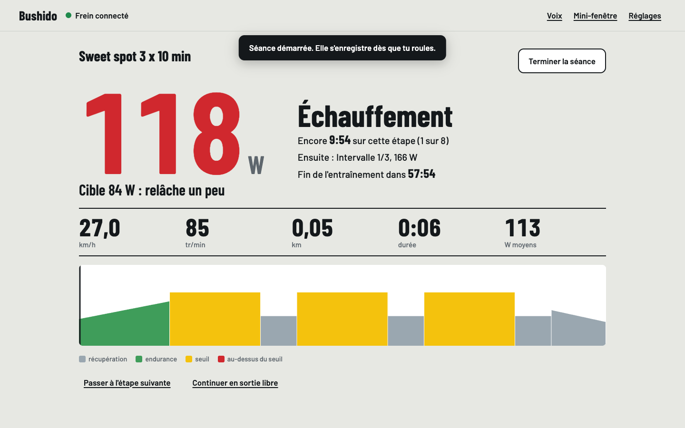

# Bushido T1981 console

**Your Tacx Bushido head unit is dead? Ride the trainer from a computer instead.**

The Tacx Bushido T1980 is a self-powered smart trainer: a T1981 brake, driven over ANT
by a T1982 head unit mounted on the handlebar. When the head unit dies, the brake is
fine but nothing can talk to it any more. This project replaces the head unit with a
computer and a USB ANT stick: a small Python server talks ANT directly to the brake,
drives its resistance, and shows a riding console in the browser.

> Independent hobby project, not affiliated with, endorsed by or supported by Tacx or
> Garmin. "Tacx" and "Bushido" are their owners' trademarks. Use it at your own risk:
> it sends resistance commands to your trainer.

## What you need

- A **Tacx Bushido T1980** (brake **T1981**). The T1982 head unit is not needed.
- A **USB ANT stick**. Tested: **CooSpo RC401**. The app looks for the USB ids
  `0fcf:1008` and `0fcf:1009` used by most ANT sticks (Garmin/Dynastream ANT USB2 and
  ANT USB-m and their clones); those should work too but have not been tested.
- A computer with **Python 3.10 or newer** and **libusb**. Tested on macOS only.
- A browser on the same computer (Chrome or Edge for the floating mini window).

The brake is powered by its own generator: it only answers while the wheel turns, so
pedal before starting the app and keep pedalling to see data.

## Install and run

    git clone https://github.com/vincemat/bushido-t1981.git
    cd bushido-t1981
    brew install libusb                      # macOS; on Linux: your distribution's libusb package
    python3 -m venv .venv
    .venv/bin/pip install -r requirements.txt
    .venv/bin/python -m bushido.app          # then open http://127.0.0.1:8981

No trainer at hand? `.venv/bin/python -m bushido.app --simulate` runs the same console
against a simulated brake and rider (data goes to `sim-data/`). Tests:
`.venv/bin/python -m pytest -q`.

Only one program can hold the ANT stick at a time: close Zwift, FortiusANT or any other
ANT software first. The console is in French.

## What works

On a real T1981 brake (November 2026):

- **Live data**: power, speed, cadence, distance, the force the brake measures, its
  temperature.
- **Resistance control**: free ride, simulated slope and raw force.
  The brake cannot hold much force below about 10 km/h; the app fades it out there.

In the app, so far tested against the simulator only:

- **ERG mode** (target power).
- **Workouts** from Zwift `.zwo` files (drop them in `workouts/` or import them from the
  page), in ERG mode.
- **Routes** from `.gpx` files with elevation (in `routes/`): the slope follows the
  profile, scaled by a realism setting. A synthetic demo climb and a few Alpine climbs
  are included.
- **Rider profiles** (mass, FTP, inertia, goals), records, weekly distance, a "ghost" of
  your best ride on a route, voice announcements.
- **Export**: each session is saved as CSV and TCX, for Strava's manual upload or
  Garmin Connect (TCX upload not yet confirmed with a real session).

## Not confirmed yet

- ERG, workouts and routes on the real brake (see above).
- **Calibration** (spin-down), from rjon65's BushidoBridge sequence
  (`bushido/calibration.py`): the sequence runs to the end on the real brake (three runs,
  raw traces in `captures/calibration_*.csv`), but the bike was mounted with a makeshift
  axle and only the last run (13.7 N) fell in the 13-19 N range the head unit accepted.
  Whether the result is right on a properly mounted bike, and whether the brake keeps it
  after a power loss, is not confirmed yet.
- Exposing the trainer to other apps (Zwift, MyWhoosh…) as an ANT+ FE-C or Bluetooth
  FTMS trainer is not done.
- Ideas and known defects: [`TODO.md`](TODO.md).

Your rides stay on your computer: sessions in `sessions/`, profiles in `profiles.json`,
both ignored by git.

## How it works

| File | Role |
|---|---|
| `bushido/constants.py` | radio parameters, page numbers, physics and limits |
| `bushido/protocol.py` | decode brake pages, encode the target force |
| `bushido/physics.py` | modes (free, slope, ERG, raw force) -> force, inertia, limits |
| `bushido/link.py` | `AntLink` (openant) and `SimulatedLink` |
| `bushido/calibration.py` | spin-down calibration state machine |
| `bushido/trainer.py` | control tick, UI commands, session |
| `bushido/workout.py` | structured workouts from Zwift `.zwo` files (targets as % of FTP) |
| `bushido/route.py` | GPX routes: smoothed elevation, gradient at a distance |
| `bushido/export.py` | session CSV -> TCX for Strava / Garmin Connect |
| `bushido/history.py` | records, weekly stats and ghosts, derived from session CSVs |
| `bushido/library.py` | `workouts/` and `routes/` files, rider profiles (`profiles.json`) |
| `bushido/session.py` | ride totals + one CSV row per second in `sessions/` |
| `bushido/app.py` | FastAPI app, WebSocket `/ws`, 4 Hz control loop |
| `bushido/static/` | the console page: `index.html`, `app.css`, `app.js`, no build step |
| `sniff_t1981.py` | raw capture / force-step script used for the first tests |
| `captures/` | raw traces recorded on the real brake |

### Protocol, as verified on the real brake

The computer is an ANT slave on the public network key, RF channel 60 (2460 MHz),
device type 81, period 4096 (8 Hz). Seven pages rotate, each about once per second.
Fields are big-endian.

| Page | Content |
|---|---|
| `01` | bytes 1-2 measured force (0.1 N), 3-4 power (W), 5-6 unknown (follows the force) |
| `02` | bytes 1-2 speed (0.1 km/h), 3 cadence (rpm) |
| `08` | bytes 1-4 distance (m) |
| `10` | bytes 1-2 alarm bits, byte 4 temperature (degC; the public description says byte 3) |
| `22` | calibration: byte 1 sub-index (3 idle/result, 6 running), byte 3 status, bytes 4-5 drag in 0.1 N |
| `04`, `ad` | not decoded |

Computer -> brake: page `01`, bytes 1-2 target force (0.1 N), re-sent every 0.25 s.
The brake keeps its last target when commands stop, so the app sends 0 on exit.

## Credits

None of this would have been possible without the people who reverse-engineered the
Bushido and shared their work. Thank you.

- **switchabl**, [Tacx legacy ANT protocol description](https://gist.github.com/switchabl/75b2619e2e3381f49425479d59523ead)
  (CC BY 4.0): radio parameters, page layouts and calibration statuses used here, then
  checked on a real brake.
- **switchabl**, [the `bushido` branch of FortiusANT](https://github.com/switchabl/FortiusANT/tree/bushido):
  the first open implementation driving a Bushido brake directly; reference for the
  channel configuration.
- **WouterJD**, [FortiusANT](https://github.com/WouterJD/FortiusANT), the project that
  branch builds on.
- **rjon65**, [BushidoBridge.py](https://github.com/rjon65/FortiusANT/blob/bushido/pythoncode/BushidoBridge.py):
  the calibration command sequence this project follows.
- **Tigge and contributors**, [openant](https://github.com/Tigge/openant): the Python
  ANT library that does the USB and radio work.

## License

GNU General Public License v3.0, see [`LICENSE`](LICENSE). The code is a new Python
implementation, but its calibration logic follows rjon65's BushidoBridge.py, part of a
GPL-3.0 FortiusANT fork, so the project keeps the same license.
